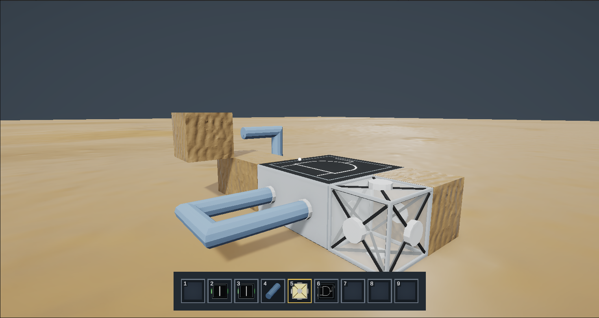
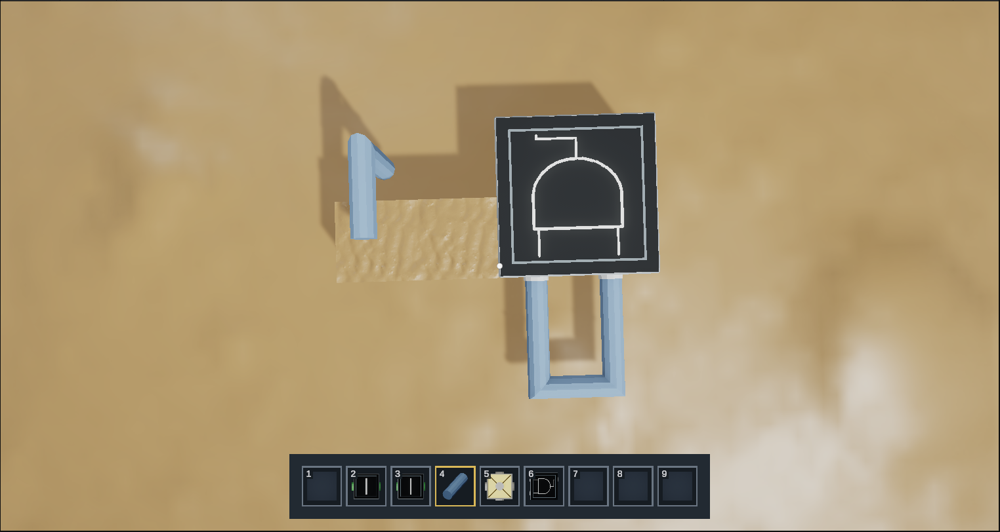
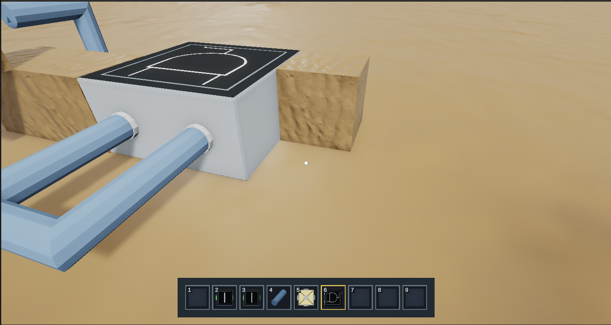
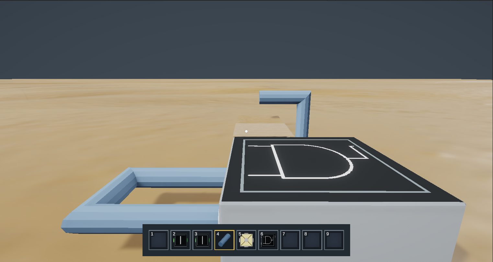

# TC-7.1: Components snap to the grid and cannot overlap

**Test Description:** Place components in the world and confirm each one snaps into the world grid (TC-7.1.1), and that a component cannot be placed into a cell another component already occupies (TC-7.1.2).  
**Module:** Circuit Building (SR-7.1)  
**Priority:** Medium  
**Pre-conditions:** Windows build from dev at `a44e403` (the UAT 1 build, SiliconSandbox-129-Windows). A new, empty world. Default controls.  

### Test Steps
**TC-7.1.1 – Grid snapping**
1. Start → New Project, name the world `TC-7.1`, and create it.
2. Select the Building Block (1) and place one on the ground while aiming at an arbitrary spot, not centred on a cell.
3. Place a second Building Block on the ground directly beside the first, again aiming off-centre.
4. Place an AND gate (6) on the ground next to them, aiming off-centre.
5. Place a Wire (4) on top of the first Building Block.
6. Look along each row from the side and from above, and screenshot the result.

**TC-7.1.2 – No overlapping components**

7. Aim at the top face of the first Building Block and right click with a Building Block selected. Note where the new block goes.
8. Place a Building Block on the ground one cell to the side of the AND gate's footprint. Then try to place a second AND gate so that one of its two cells would land on that Building Block.
9. Try to place an LED (5) while aiming directly at the side of the existing AND gate, at the cell it already occupies.
10. Break the extra blocks and confirm the original components are unchanged. Screenshot steps 8 and 9.

### Expected Results
- **TC-7.1.1:** Every component sits exactly on a grid cell, whichever point of the face was aimed at. Neighbouring blocks line up edge to edge with no gaps, offsets or rotation drift. The wire sits centred in the cell above the block.
- **TC-7.1.2:** A new component is only ever placed in an empty cell (step 7: on top of the block, not inside it). In steps 8 and 9 the placement is refused or moved to a free cell; no two components ever share a cell, and the existing components are not moved or replaced.

### Evidence
- 
- 
- 
- 

### Test Log  
|Tester Name|Test Date|Success?|Additional Comments|
|---|---|---|---|
|Grayson Dufilho|11/1/26|Yes|All components snapped to grid cells; no placement ever shared a cell with an existing component.|
