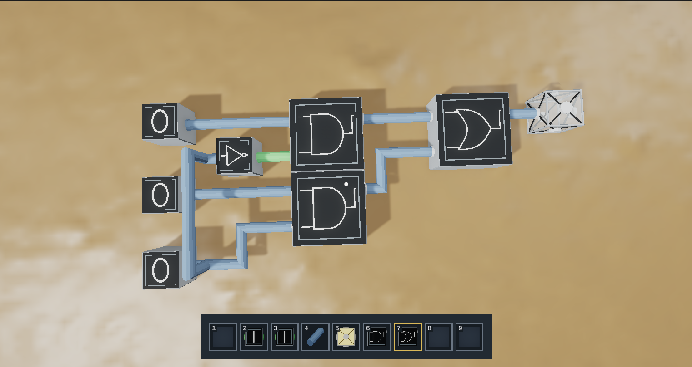
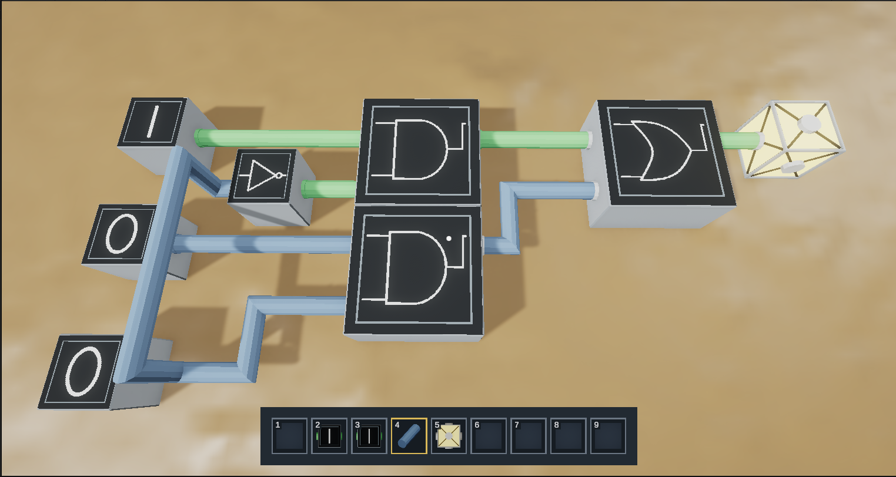
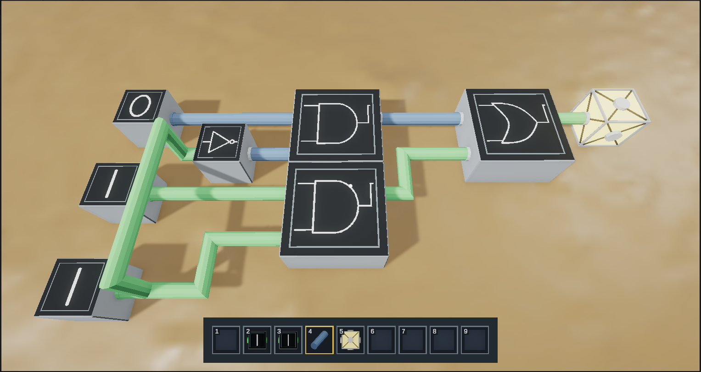

# TC-7.3.1: Benchmark circuit output matches real output

**Test Description:** Build a 2-to-1 multiplexer in game from logic gates, sources, wires and an LED, then step through every input combination and confirm the LED matches the multiplexer's real truth table.  
**Module:** Circuit Building (SR-7.3) / Logical Simulation  
**Priority:** High  
**Pre-conditions:** Windows build from dev at `a44e403` (the UAT 1 build, SiliconSandbox-129-Windows). A new, empty world. Default controls (F toggles a source).  

### Circuit Under Test
2-to-1 multiplexer: **Y = (A AND NOT S) OR (B AND S)**. When S = 0 the LED follows A; when S = 1 it follows B.

| Part | Count | Hotbar / inventory |
|---|---|---|
| Source (A, B, S) | 3 | 3 Ground Source (starts at 0) |
| NOT gate | 1 | 7 |
| AND gate | 2 | 6 |
| OR gate | 1 | 8 |
| Wire | as needed | 4 |
| LED | 1 | 5 |

### Test Steps
1. Start → New Project, name the world `TC-7.3.1`, and create it.
2. Place three Ground Sources in a column. In your notes, the top source is A, the middle is B, and the bottom is S (select).
3. Place the NOT gate with its input facing S. Wire S to the NOT input.
4. Place AND #1. Wire A to one input and the NOT output to the other input.
5. Place AND #2. Wire B to one input and S to the other input (S now feeds both the NOT gate and AND #2 from one wire network).
6. Place the OR gate. Wire the AND #1 output to one input and the AND #2 output to the other.
7. Place the LED and wire the OR output to it.
8. Confirm no wire shows the multiple-driver error colour.
9. With all sources at 0, record the LED state in the results table below.
10. Toggle the sources with F to step through the remaining seven combinations in the order of the table, recording the LED each time.
11. Take a screenshot of the full circuit, plus one screenshot each for rows 3 (S=0, A=1, B=0) and 6 (S=1, A=0, B=1).
12. Escape → Save & Exit, reload the world, and repeat row 6 to confirm the circuit still evaluates after a reload.

### Expected Results
- The circuit builds with no multiple-driver errors (step 8).
- The LED matches the **Expected Y** column for all 8 rows.
- After the reload in step 12, row 6 still lights the LED.

| Row | S | A | B | Expected Y | Observed LED |
|-----|---|---|---|------------|--------------|
|   1 | 0 | 0 | 0 |          0 |            0 |
|   2 | 0 | 0 | 1 |          0 |            0 |
|   3 | 0 | 1 | 0 |          1 |            1 |
|   4 | 0 | 1 | 1 |          1 |            1 |
|   5 | 1 | 0 | 0 |          0 |            0 |
|   6 | 1 | 0 | 1 |          1 |            1 |
|   7 | 1 | 1 | 0 |          0 |            0 |
|   8 | 1 | 1 | 1 |          1 |            1 |

### Evidence
- 
- 
- 

### Test Log  
|Tester Name|Test Date|Success?|Additional Comments|
|---|---|---|---|
|Grayson Dufilho|11/1/26|Yes|All 8 input combinations matched the 2-to-1 mux truth table.|
