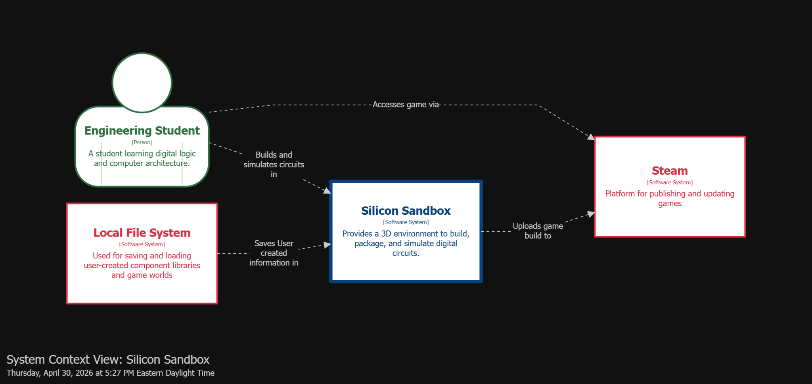
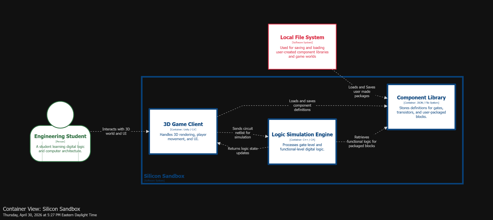
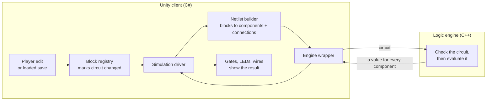
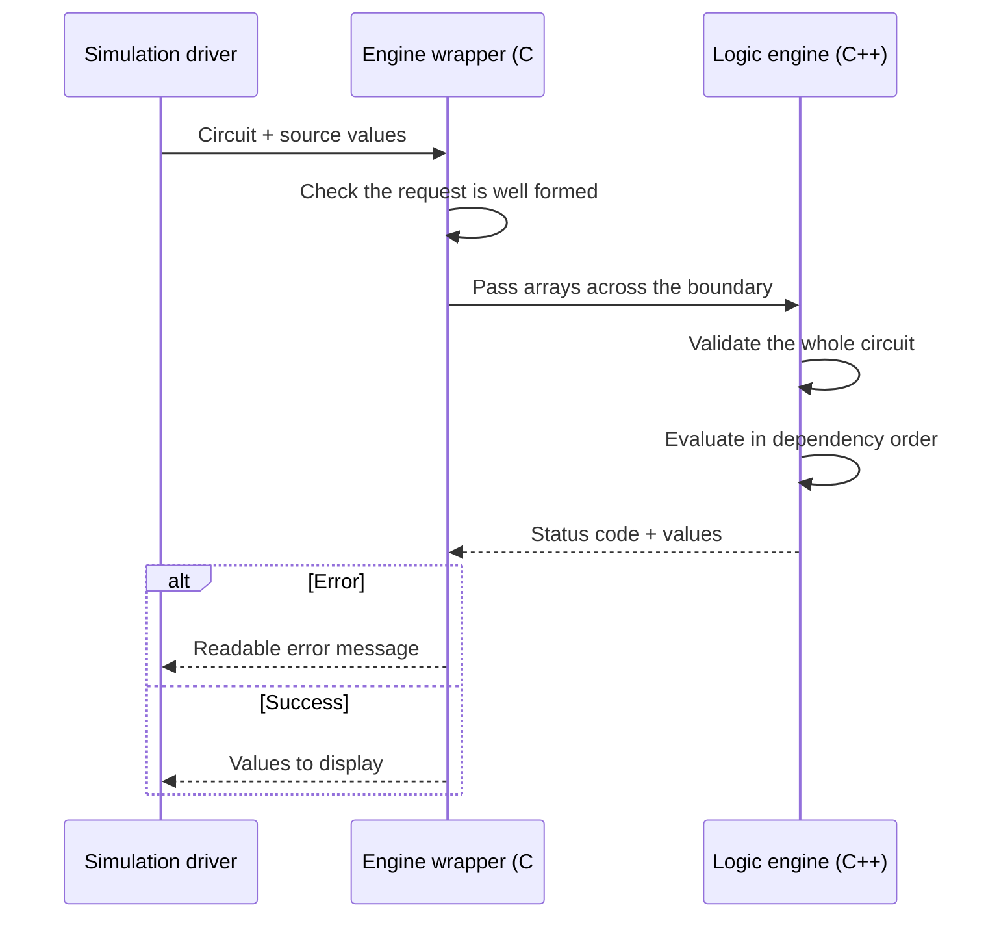
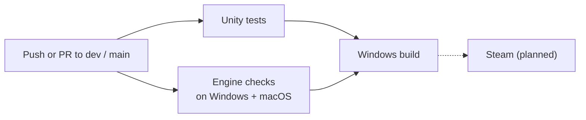

# Explanation — Silicon Sandbox

This document explains how Silicon Sandbox is built and why it works the way it does. It builds on our semester-1 design document and brings it up to date with the current project. For exact APIs and values see the reference; for step-by-step tasks see the how-to guide.

Applies to: `dev` branch, version `0.7.3`.

**Contents**

- [System Overview](#system-overview)
- [Architecture Diagrams](#architecture-diagrams)
- [Key Components](#key-components)
- [Design Decisions](#design-decisions)
- [Tradeoffs and Limitations](#tradeoffs-and-limitations)

---

## System Overview

Silicon Sandbox is a 3D logic-simulation game inspired by Minecraft redstone. It is designed for computer engineers, digital design students, or anyone curious about logical circuitry. Its primary focus is an educational tool; its secondary focus is a game-like experimental sandbox.

**Why it exists.** Digital systems can be complex and difficult to understand, and existing tools each leave a gap:

- RTL and block diagrams help, but are flat, make details easy to miss, and don't show expected behaviour.
- Simulation languages (e.g. Verilog) don't show connections visually and are difficult to trace through.
- Current visual simulators are mostly 2D, which doesn't follow how people understand space and connection.
- 3D simulators lack abstraction, so large designs must be built solely from low-level objects.

**How it works.** Players place gates, sources, wires, and LEDs on a block grid, and the circuit simulates live. Two backend paths run locally on the player's machine:

- **Simulation:** a C++ logic engine, compiled to a native plugin and called from C#.
- **Persistence:** worlds stored as JSON files in the user's app data folder.

A simulation driver ties them to the game: it builds the circuit from placed blocks, calls the engine, and displays the results.

### Figure 1 — System context (semester 1, still current)

The context from our first design still holds: an engineering student builds and simulates circuits in Silicon Sandbox, which saves to the local file system and will be distributed through Steam. Steam distribution and user-created component libraries are still planned.

### Current state

| Area | Status |
| --- | --- |
| Built | Combinational circuit logic; 8 gate types; sources, clock, and LEDs; player movement and interaction; block placing and breaking; wires with automatic routing; inventory and hotbar; world save and load; rebindable controls; Windows and macOS support; automated testing and builds |
| In review | Clocks and sequential logic (stateful ticks), PR #141 |
| Planned | Packaging, restoring past saves (backups), world copy and sharing, Steam release |

---

## Architecture Diagrams

### Figure 2 — Container view (semester 1)

This was our original architecture. The overall shape has held up; what changed is below.

| Semester-1 container | Today |
| --- | --- |
| **3D Game Client** (Unity / C#) | Built as designed: rendering, movement, and UI. It now also holds the block registry, netlist builder, simulation driver, and save system. |
| **Logic Simulation Engine** (C++ / C#) | Built as a C++ native plugin with one thin C# wrapper. Gate-level logic works; functional-level logic for packaged blocks does not exist yet. |
| **"Sends circuit netlist" / "Returns logic state updates"** | This is exactly the current interface: arrays of components and connections go in, one value per component comes back. |
| **Component Library** (JSON / file system) | Not built yet. Only world saves exist; packaged components are the next major milestone. |
| **Local File System** | Holds world saves (JSON) and keybinds (Unity PlayerPrefs). |

### Figure 3 — Whole system today: data flow and trust boundaries

Figure 3 is the current, detailed version of Figure 2, drawn for our security design review. Blue shapes are processes, orange are privileged processes, brown are data stores, and dashed grey shapes are planned. Red dashed boxes are trust boundaries.

We drew a boundary anywhere the game starts using data it did not create itself. Anything on the player's disk, such as world saves, keybinds, or the game files, can be edited outside the game, so it is treated as untrusted. The most privileged step is calling the C++ plugin, which has the same access to the computer as the player, which is why the engine checks every count and index before using it. The remaining boundaries cover how the code reaches players: GitHub, the CI pipeline, and Steam.

Since this diagram was drawn, a macOS build of the plugin has been added next to the Windows one.

### Figure 4 — How a change becomes a result

Figure 4 zooms in on the centre of Figure 3, the core of the game. Nothing runs while the world is still; any change triggers one full evaluation on the next frame.

### Figure 5 — Who checks what

Errors always come back as codes, never as crashes, and the wrapper turns them into messages that name the problem.

### Figure 6 — Build and verification

---

## Key Components

### How the components interact

- Placing a block or flipping a source marks the circuit as changed.
- The netlist builder scans the blocks and follows connected wires to produce arrays of components and connections (plain integers).
- C# writes the source values into a shared state array; the engine writes every component's 0 or 1 back into it.
- The driver passes the results to gates, LEDs, and wires, which only display what the engine tells them.
- Saving and simulation are independent: a loaded world just recreates blocks, which flow through the same path.

### Unity client

Handles movement, placing and breaking blocks, toggling sources, menus, controls, and the inventory. It never computes logic; it only adds and removes blocks. Unity also makes it easy to connect frontend and backend scripts and to drag and drop components that need to be modified at runtime.

Wire routing is the one heavy job on this side. When a player connects two points, the route is searched on a background thread, so long wires never freeze the game.

### Block registry

Keeps track of what occupies every grid cell, including gates that span several cells. Whenever the circuit changes, it marks the circuit as changed, which is how the simulation knows there is work to do.

| Block | Role |
| --- | --- |
| Gate | One of AND, OR, NOT, NAND, NOR, XOR, XNOR, BUFFER |
| Source | Outputs a 0 or 1 set by the player; the clock flips on a timer |
| LED | Lights when its input is high |
| Wire | Carries a signal between blocks |

### Netlist builder

Turns the placed blocks into the engine's input: a netlist of basic **components** (sources, the 8 gate types, and LED outputs) and **connections** between them. Touching wires are merged into one network, so a long wire becomes a single connection rather than many pieces. The same world always produces the same netlist, which keeps testing and bug reports repeatable.

### Simulation driver

Runs the pipeline in Figure 4. It starts automatically with the game, re-runs only when the circuit changes (not every frame), builds the netlist, sends it to the engine, and updates every block's display. If the engine is missing or reports an error, everything shows as off instead of showing stale values.

### Engine wrapper

The only C# code that talks to the C++ engine. It checks requests before sending them and turns the engine's error codes into clear messages. It has no Unity dependency, so it is also tested on its own in CI.

### Logic engine

The C++ native plugin. It is stateless: one call evaluates the whole circuit.

- Gates are evaluated in topological order, so each gate runs once, after its inputs.
- Every signal is 0 or 1. Results come back as a code: OK, feedback loop found (gates in the loop read 0), or invalid circuit (all outputs held low).
- One driver per wire: two outputs on the same wire is flagged as an error.
- Only one small file knows it is a plugin; the rest is plain C++, so it is tested without Unity. The same code is built for Windows and macOS.

### Save system

World saves are stored as JSON files (Unity JsonUtility) in the user's app data folder:

- **Create:** the New World page makes `<world>.json` in the `Worlds` folder.
- **Retrieve:** the Load World page lists every save; loading clears the scene and rebuilds each block from its prefab.
- **Update:** placing a block marks the world changed; it saves 0.5 s after the last change, and on quit or pause.
- **Delete:** the Load World page removes the file.

Each block stores its prefab name, position, rotation, scale, ground flag, and, for wires, which sides connect. Signal values are not stored; they are recomputed when the world loads. A world that fails to load is never overwritten.

### Build and verification

The CI pipeline (Figure 6) packages the game as a Windows x64 standalone build:

1. **Check out the repository** with large assets (Git LFS).
2. **Verify the committed native plugin** on Windows and macOS: load it through the C# wrapper and check every gate against its truth table, plus whole circuits.
3. **Run the Unity tests** (EditMode and PlayMode); any failing test fails the job.
4. **Build the Windows player**, only if steps 2 and 3 pass.
5. **Store the build** as a downloadable artifact.

Its external dependencies are the Unity license (stored as repository secrets), GitHub-hosted runners, Git LFS storage, the Unity package registry, and, for release, Steamworks.

---

## Design Decisions

### Technology stack (updated from semester 1)

| Technology | Scope | Reasoning (semester 1) | Status now |
| --- | --- | --- | --- |
| Unity | Core game engine | Manages the 3D environment, physics, and user interface | In use (Unity 6, URP, Input System) |
| C# | Scripting and logic | Language used in Unity for player information and interactions with the environment | In use; also the netlist builder and engine wrapper |
| C++ | Logic simulation | Language used for the logic simulation of the complex circuits | In use |
| Native plugin | Logic integration | Bridges the C# code in Unity with the C++ code of the logic simulation | In use: Windows DLL and universal macOS library |
| ~~Newtonsoft.Json~~ → Unity JsonUtility | Data serialization | Save and load the data of worlds and packages | **Changed:** JsonUtility handles our flat format with no extra dependency |
| ~~NUnit~~ → Unity Test Framework | Automated testing | Verify game functionality, logic gates, and simulations | **Changed in name only:** the Unity Test Framework is built on NUnit |
| GitHub Actions | Automated testing | Automate all testing when the codebase is updated | In use, with GameCI actions to run Unity headless and build |
| ~~GoogleTest~~ → C++ test programs + PluginCheck | Engine testing | Test the C++ logic simulation accuracy | **Changed:** standalone C++ test programs, plus a .NET check that loads the real plugin on Windows and macOS in CI |
| Local file system | Storage | Save local data and packages | In use for world saves; packages not built yet |
| Git LFS | Source control | — | **Added** for large binary assets (3D models) |

### Semester-1 design trades and where they stand

| Trade | Options (score) | Chosen | Status now |
| --- | --- | --- | --- |
| 1. How packaged components are stored | Static truth table (75), hierarchical simulation (80), stored circuit with cached truth table (81) | Hybrid stored circuit + cached truth table | Not built yet |
| 2. Simulator type | Event-driven (8.25), cycle-based (7.75), data-parallel GPU (6.15) | Event-driven | Evolved; see decision 6 |
| 3. Netlist synthesis for packages | Direct gate copy (31), brute-force look-up table (30), traditional logic synthesis (30) | Direct gate copy | Not built yet; the current netlist format is its foundation |

The hybrid storage was chosen because it covers the weak points of each model with the strengths of the other: it packages as quickly as hierarchical simulation, is faster on average during long simulations, and keeps the original circuit so packages stay editable. Direct gate copy was chosen because it is easy to implement and keeps the original gates, so players can re-expand a package to study the lower levels of abstraction. Both still stand for the packaging milestone.

### 1. The logic runs in C++, not in Unity

Using Unity for both simulation and rendering would be slow, because Unity is not optimized for complex data simulation (NFR-2). Keeping the logic in a separate C++ engine keeps it fast as circuits grow, separates it from rendering, and let us test it before the game could place a single gate. *Rejected:* evaluating gates inside Unity objects, which is simpler at first but ties logic to the frame rate and does not scale.

### 2. The C# to C++ boundary is kept as simple as possible

Only whole numbers and arrays of whole numbers cross it; the C# side owns all the memory; and failures come back as error codes, never as exceptions. Each rule removes a class of hard-to-find bugs. For example, signals are plain integers rather than true/false values because the two languages store true/false in different sizes, which gives silently wrong answers instead of an error. *Rejected:* a richer interface with objects and strings, which is harder to keep correct across two languages and two platforms.

### 3. The circuit is described as components and connections, and wires are not components

Wires carry a signal but compute nothing, so the client merges them before sending the circuit. This keeps the engine's work proportional to the logic, not to how long the wires are. Component type numbers are fixed and only ever added to, because they will be stored in save files; zero means "invalid," so a missing value is caught instead of being read as an AND gate.

### 4. Only one output may drive a wire

If two outputs touch the same wire, it is a short circuit: the wire turns red and its inputs read 0. Players combine signals with an OR gate, as they would in a real circuit. *Rejected:* our earlier behaviour, where wires merged every signal they touched. It was forgiving but hid mistakes and taught a habit that fails on real hardware.

### 5. The engine is the single source of truth

Blocks never work out their own values; they only display what the engine computed. The display can never disagree with the simulation, and the logic can be tested with no blocks at all. The simulation also runs only when something changes, so an idle world costs nothing.

### 6. Simple evaluation now, timed ticks next

Today, every change re-evaluates the whole circuit once, in order. This is exact for circuits without feedback, which covered everything the mid-semester demo needed, and it is easy to verify. The next step (PR #141) adds ticks where every gate takes one step to respond, the same model as gate-level Verilog and close to how redstone behaves. That is what makes latches, flip-flops, and the clock work. Feedback loops are reported, not rejected, because loops are how memory works in logic (requirement SR-3.3).

*Change from semester 1:* Trade 2 chose an event-driven simulator because it only updates the affected components and supports timing propagation. That is still the long-term goal: event-driven simulation is a speed-up of the tick model, not a different design. Building the simple version first gives us a correct reference to test it against.

### 7. Saves are plain JSON files that are never overwritten after a failed load

One readable file per world is easy to debug and back up. Saving shortly after the last edit turns a burst of changes into one write. Refusing to save after a failed load prevents the worst outcome for a player: an empty world replacing hours of work.

### 8. Ready-built engine files are kept in the repository

The Windows and macOS engine files are built from the same source and committed, so teammates can run the game without a C++ compiler. Both are self-contained, because a missing helper library looks exactly like a missing engine.

### 9. Gate connection points are data, not code

Where each gate's inputs and output sit is stored in one table. When two-input gates grew from one cell to a 2×1×2 block, only the table changed.

### Scalability considerations

| Requirement (Final SDP) | How the architecture addresses it |
| --- | --- |
| **NFR-1:** at least 60 FPS when simulating 1,000 gates or fewer | Simulation runs in C++ and only when the circuit changes. Each evaluation visits every component once. Not yet measured at 1,000 gates. |
| **NFR-2:** a native C++ library as the simulation engine | Met (decision 1). |
| **NFR-3:** new base blocks can be added to the inventory | The inventory is a data-driven catalog and gate connection points are a table (decision 9), so a new block is a new prefab and catalog entry. |
| **NFR-8:** gates follow IEEE timing constraints | Not met. The planned tick gives every gate the same one-step delay; real propagation and setup/hold times would need per-gate delays. |

---

## Tradeoffs and Limitations

| Limitation | Why we accepted it | Next step |
| --- | --- | --- |
| Every change re-evaluates the whole circuit | Exact, simple, and fast enough for current circuits | Ticks (PR #141), then event-driven updates; measure NFR-1 |
| No feedback loops yet; gates on a loop read 0 | Feedback was outside the demo scope | Ticks in PR #141, then a clock that counts ticks (#69) |
| Equal gate delays (NFR-8 not met); for example, a latch released from S = R = 1 oscillates unrealistically | One delay for every gate is predictable and easy to reason about | Different delays per gate type, or an "unknown" state, later |
| The engine's types are copied by hand into C# | The boundary is small enough to manage | CI now tests every gate through the real wrapper, after an outdated engine file once silently lacked five gate types |
| The plugin is prebuilt: CI tests the committed files but does not rebuild them, and the macOS file needs a Mac to rebuild | Lets the team run the game without a compiler | Optionally rebuild and compare in CI |
| The player build is Windows only, and the executable is not code signed, so Windows warns when it is launched outside Steam | Windows is the first release target | macOS player build later; Steam distribution |
| CI artifacts are kept for 90 days | Enough for testing builds | Keep release builds permanently on Steam or as GitHub Releases |
| No Linux engine, so Linux CI skips simulation tests | Linux is not a target platform | Covered by the Windows and macOS engine checks |
| Saves store blocks only (no signal values, player position, or hotbar), with no backups and no size limits; a crafted world file is the main security risk identified in our security review | Enough to save and reload a circuit's structure | World backups, a new save version, and the import validation planned in the security review |
| Packaging (integrated circuits) is not built yet | The core simulation had to work first | Next major milestone, using the semester-1 trade decisions above |

---

*Builds on:* Semester-1 Design Document (context and container views, technology stack, design trades), Final SDP (NFRs), Mid-Semester Demo (backend integration), Packaging & Release (packaging strategy), and Security Design Review (data flow diagram and trust boundaries).
